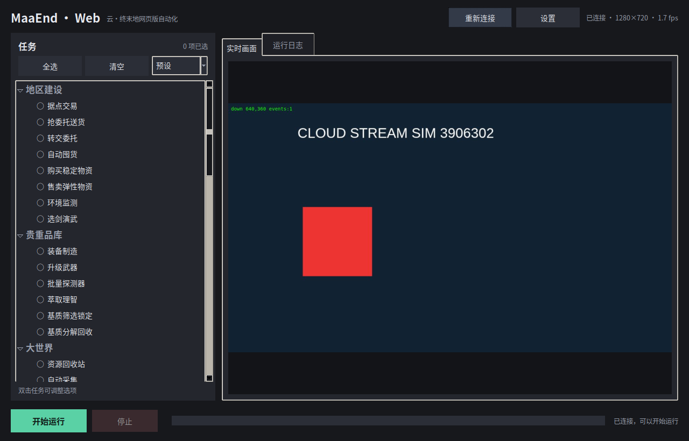

# MaaEnd-Web

把 [MaaEnd](https://github.com/MaaXYZ/MaaEnd) 的全部自动化能力，接到 **《云·终末地》网页版** 上。

不需要模拟器，不需要安卓设备，不需要把浏览器窗口摆成固定位置——MaaEnd 的 Pipeline 原封不动跑在浏览器里。

```
                        ┌──────────────────────────────┐
                        │   Chrome / Edge（独立配置）   │
                        │   https://endfield.hypergryph │
                        │   /cloud                      │
                        └──────────────┬───────────────┘
                                       │ CDP
                     截图 / 点击 / 键盘 / 相对移动
                                       │
┌──────────────────────────────────────┴──────────────────────────────────────┐
│                          MaaEnd-Web（Python）                                │
│                                                                              │
│   WebController (CustomController)  ──►  MaaTasker  ──►  Pipeline (assets)   │
│                                            │                                 │
│                                            └──► AgentClient ──► go-service   │
│                                                              cpp-algo       │
└──────────────────────────────────────────────────────────────────────────────┘
```



## 这是什么

MaaEnd 官方安装包支持 PC（Win32 窗口）、安卓（ADB）、macOS、Linux 四类控制器，
其中 `CloudADB` 面向「云·终末地」**安卓客户端**。

网页版是另一条链路：游戏画面是浏览器里的 H.264/AV1 视频流，输入要走 DOM 事件，
既没有窗口句柄可抓，也没有 ADB 设备可连。MaaEnd-Web 补齐的就是这一层：

| 能力 | 实现方式 |
| --- | --- |
| 截图 | `Page.captureScreenshot`，输出无损 PNG，裁剪归一化到 1280×720 |
| 点击 / 滑动 | `Input.dispatchMouseEvent`，坐标经几何反变换回视口 |
| 键盘 | `Input.dispatchKeyEvent`，Win32 VK → DOM `key`/`code`/`keyCode` |
| 3D 视角 | Pointer Lock 下的虚拟光标累加位移，不受屏幕边界限制 |
| 任务调度 | 直接复用 MaaFramework 的 Tasker + MaaEnd 的 `assets/resource` |
| 战斗 / 寻路 / 基质识别 | 复用 MaaEnd 自带的 `agent/go-service`、`agent/cpp-algo` |

## 快速开始

### 1. 准备

- Windows 10/11、macOS 12+ 或 Linux（x86_64）
- Python 3.10+
- Chrome / Edge（Chromium 111+）
- 一份 **MaaEnd 官方安装包**（内含 `assets/`、`agent/`、OCR 模型）
  - 官网下载：<https://maaend.com/>
  - 从源码运行的话，需自行编译 `agent/go-service` 与 `agent/cpp-algo`，否则依赖 Agent 的任务不可用

### 2. 安装

```bash
# Windows：双击 run.bat
# macOS / Linux：
./run.sh
```

首次运行会自动建虚拟环境并安装依赖。也可以手动：

```bash
pip install -r requirements.txt
python main.py
```

### 3. 首次配置

1. 打开程序 → 点击「设置」
2. **MaaEnd 目录**：选择 MaaEnd 安装目录（含 `interface.json` 的那一层）
3. 其余保持默认，保存

### 4. 登录一次

点击「连接并进入游戏」后，程序会：

1. 在独立的浏览器配置里启动 Chrome/Edge（不影响你日常用的浏览器）
2. 打开《云·终末地》网页版
3. 如果停在登录页，会提示你**手动完成鹰角通行证登录**
4. 登录后再次点击「连接并进入游戏」，程序自动点「开始游戏」并等待进入

登录态保存在独立配置目录里，之后无需重复登录。

### 5. 跑任务

勾选左侧任务 → 「开始运行」。双击任务可以调整该任务的选项（与 MXU 里的选项一致）。

选项支持 PI V2 的全部类型：`switch` / `select` / `checkbox`（多选，含
`min_count` / `max_count` 约束）/ `input`（数字、文本、密码、正则校验）/
`hotkey`（按键捕获），以及 case 里的嵌套子选项——切换分支会实时改变可见项。

## 为什么这样设计

### 不用 Win32 截浏览器窗口

窗口截图会带上地址栏、标签栏、书签栏，而且一旦窗口被遮挡、最小化或缩放，
坐标全乱。更麻烦的是它需要窗口置顶并抢占鼠标，挂机时电脑不能干别的。

走 CDP 则是**直接拿到渲染层**：没有浏览器 UI、不需要窗口可见、不抢鼠标，
窗口可以缩到任务栏，电脑照常用。

### 强制 1280×720 视口

MaaEnd 的所有坐标都以 1280×720 为基准。只要截图不是这个尺寸，
MaaFramework 会做一次等比缩放，Pipeline 里的 `roi` 就会出现系统性偏移——
不是偏 1~2 像素，而是整块 ROI 错位。

所以连接时用 `Emulation.setDeviceMetricsOverride` 把页面视口钉死在 1280×720。
好处是双份的：云游戏服务端会按视口尺寸协商视频流，等于**让云端按识别基准编码**，
画质和识别精度同时最优。

### 视频流压缩到底有多大影响

这不是拍脑袋的结论。仓库里的 [`tests/quality_experiment.py`](tests/quality_experiment.py)
拿 MaaEnd 真实的 Pipeline 节点做了对照实验：把模板贴进对应 ROI，再模拟云游戏的
「缩放 → 编码 → 解码 → 拉伸」链路，记录 TemplateMatch 得分。

15 个有效节点（原图得分 ≥ 0.90）的结果：

| 模拟条件 | 平均得分 | 最低分 | < 0.70 占比 |
| --- | --- | --- | --- |
| 原图（无损） | 0.993 | 0.964 | 0% |
| 视频流 90 质量 | 0.991 | 0.962 | 0% |
| 视频流 70 质量 | 0.984 | 0.947 | 0% |
| 视频流 50 质量 | 0.977 | 0.929 | 0% |
| 缩放到 0.72 再编码 | 0.691 | 0.000 | **27%** |
| 缩放 + 编码 + 锐化 | 0.821 | 0.000 | 13% |

结论很明确：

- **编码压缩几乎无害**。哪怕压到 50 质量，得分也只掉 1.6 个百分点，`< 0.70` 占比仍是 0%。
- **缩放才是杀手**。画面被拉伸 1.4 倍后，四分之一以上的节点直接掉到阈值以下。
- 锐化能挽回一部分（0.69 → 0.82），但救不回全部。

所以本项目的策略是「**优先保证 1:1，锐化只作为兜底**」：控制器检测到画面被放大时
才启用反锐化掩模，1:1 时锐化保持关闭——否则反而会干扰 ColorMatch 节点。

### 相对移动与 Pointer Lock

3D 游戏需要转视角。浏览器在 Pointer Lock 下用 `movementX/Y`（两次鼠标位置的差值）
计算转动量，而 CDP 的 `Input.dispatchMouseEvent` 传的是绝对坐标。

实测发现 Chrome 对 CDP 传来的坐标**不做视口裁剪**：传 `(100000, 100000)` 也照收，
并且正确地换算成位移。于是控制器内部维护一个可以跑到 ±90000 的虚拟光标，
连续转向几万像素也不会撞到边界、不会出现视角突跳。

（如果云游戏用的是「按住右键拖拽」而不是 Pointer Lock，设置里可切换 `look_mode`。）

## 功能覆盖

Pipeline 层面与 MaaEnd 的 `Win32-Front` 完全一致——任务适用性按 PC 端判定。
实际能跑多少，取决于两点：

- **是否带 Agent**：MaaEnd 的 1390 个节点里有 222 个是 `Custom` 类型（战斗、寻路、
  基质扫描、拼图求解等）。没有 `agent/go-service` 与 `agent/cpp-algo`，这些任务会失败。
- **云端限制**：云游戏有排队、时长、掉线重连，这些不在自动化范围内。

本机实测通过的链路：

| 项目 | 结果 |
| --- | --- |
| 资源加载（`resource` + `resource_cloud`） | 1390 个节点，加载成功 |
| 真实节点识别 | `InStashProgressionTab` 命中框与注入位置**逐像素一致** |
| 点击 / 长按 / 滑动 / 滚轮 | 页面 HUD 回显坐标正确 |
| 键盘 / 文本输入 | `keyDown`/`keyUp`/`insertText` 正常 |
| 相对移动（Pointer Lock） | 位移累计正确，可连续转向 |
| Agent 子进程 | `go-service` 启动、连接，注册 **43 个自定义识别 / 91 个自定义动作** |
| Custom 动作任务 | `CloseGamePC`（依赖 `CloseGameAction`）由失败转为成功 |
| 任务队列与选项合并 | switch / select / checkbox / input / hotkey / 嵌套选项全部生效 |

## 常见问题

**Q：提示「未找到 Chrome / Edge」**
A：设置里手动指定浏览器可执行文件路径。必须是 Chromium 内核（Chrome、Edge、Brave、Chromium 均可）。

**Q：连接成功但预览是黑的**
A：说明页面还没进入游戏画面。先完成登录并点「开始游戏」。预览区显示的是控制器
实际看到的画面，如果它是黑的，识别也不会有结果。

**Q：识别总是差一点 / 经常点偏**
A：先看右上角的视口是不是 `1280×720`。
- 如果是，但画面区小于 1280×720（预览里有黑边），说明云游戏没有按视口铺满，
  此时检查设置里「强制 1280×720 视口」是否被关掉了。
- 如果视口不是 1280×720，把「强制 1280×720 视口」打开。

**Q：任务跑到一半卡住**
A：云游戏断流或弹出了时长/排队提示。看预览确认画面状态，手动处理后重新运行。

**Q：能不能后台挂机**
A：可以。浏览器窗口最小化也能跑（已关闭后台节流）。但**不要关闭**标签页。

**Q：为什么不直接做成 MaaEnd 的一个控制器选项**
A：MaaFramework 的 ProjectInterface V2 目前只支持 `Adb / IOS / Win32 / MacOS /
PlayCover / Gamepad / Linux` 七种控制器，没有 `Custom`（[上游 issue #1271](https://github.com/MaaXYZ/MaaFramework/issues/1271) 仍在排期中）。
所以本项目自带一个小型启动器，直接调 MaaFramework 的 C API 创建 `CustomController`，
其余全部复用 MaaEnd 的资源和 Agent。

## 项目结构

```
MaaEnd-Web/
├── main.py                    入口（GUI / CLI / 自检）
├── maaend_web/
│   ├── cdp.py                 Chrome DevTools Protocol 客户端
│   ├── browser.py             浏览器发现、启动、标签页接管
│   ├── geometry.py            画面区域探测、裁剪归一化、坐标映射
│   ├── input_map.py           Win32 VK → DOM 键盘事件
│   ├── controller.py          WebController（MaaFramework CustomController）
│   ├── project.py             ProjectInterface V2 解析（任务 / 选项 / 预设）
│   ├── runner.py              Resource + Tasker + Agent 组装
│   ├── diagnostics.py         环境自检
│   ├── cli.py                 命令行模式
│   └── ui/                    桌面控制台
└── tests/                     画质实验、识别链路探针、UI 冒烟测试
```

## 命令行

```bash
python main.py --check                       # 环境自检
python main.py --tasks DailyRewards,Dijiang  # 直接跑指定任务
python main.py --port 9222                   # 接管已开调试端口的浏览器
```

## 说明

- 本项目只做「读画面 + 发输入」，不读写游戏内存、不修改游戏文件。
- 使用前请阅读《云·终末地》用户协议；因自动化产生的账号风险由使用者自行承担。
- 本项目不含 MaaEnd 的任何资源文件：Pipeline、模板图、OCR 模型、Agent 可执行文件
  全部在运行时从你本地安装的 MaaEnd 读取。
- 本项目以 AGPL-3.0 发布，与 MaaEnd 保持一致。
